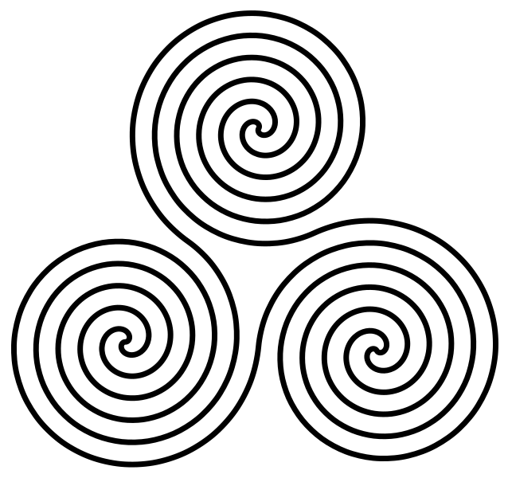

```
 aug ~ sep ~ oct
       /_/
      /  2026
```

A few things I saved over the past three months:

- [The human is the loop](https://brentfitzgerald.com/posts/the-human-is-the-loop/), Gwern’s [Guardian Angels](https://gwern.net/guardian-angel), and [The Whispering Earring](https://gwern.net/doc/fiction/science-fiction/2012-10-03-yvain-thewhisperingearring.html). Read separately; all circle around agency.

- Oak Lab’s [Learning from experience instead of curated datasets](https://oaklab.ai/posts/learning-from-experience-instead-of-curated-datasets). On learning what to ignore in noisy experience.

- The [triskelion](https://en.wikipedia.org/wiki/Triskelion), the motif with three spirals or three legs radiating from a center, used in flags and coats of arms:

<figure style="text-align: center; margin: 1.5em 0;">
  <a href="https://commons.wikimedia.org/wiki/File:Triple-Spiral-Symbol.svg">
    
  </a>
</figure>

- [Kizhi Pogost](https://en.wikipedia.org/wiki/Kizhi_Pogost), whose Transfiguration Church has a timber frame built without nails!

<figure style="text-align: center; margin: 1.5em 0;">
  <a href="https://commons.wikimedia.org/wiki/File:Kizhi_06-2017_img08_Pogost_view.jpg">
    
  </a>
  <figcaption><small>Photo: A.Savin, Wikipedia · <a href="https://artlibre.org/licence/lal/en/">Free Art License</a>.</small></figcaption>
</figure>

- Via [moultano](https://x.com/moultano/status/2106069910413779294), [Cloacina](https://en.wikipedia.org/wiki/Cloacina), Rome's sewer goddess.

- The [Kuleshov effect](https://en.wikipedia.org/wiki/Kuleshov_effect). Makes me wonder how neighboring posts change what we read into something on social media.

- Via [@selfiesconfruta](https://x.com/selfiesconfruta/status/2105356460444299607), [Geerat J. Vermeij](https://en.wikipedia.org/wiki/Geerat_J._Vermeij), a paleontologist who has been blind since the age of three and studies shells through touch.

Finally, a song: [little lizard :-)](https://open.spotify.com/track/1KbDytCkvoXj7UQem0MrNK).

<iframe title="Spotify player: little lizard :-) by Tennyson" src="https://open.spotify.com/embed/track/1KbDytCkvoXj7UQem0MrNK" width="100%" height="152" style="border: 0; border-radius: 12px;" allow="autoplay; clipboard-write; encrypted-media; fullscreen; picture-in-picture" allowfullscreen loading="lazy"></iframe>

🍀

---
